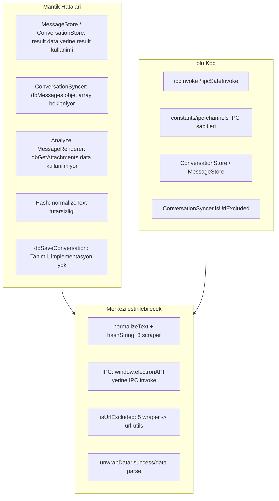

# Hayalet-ev Proje Analiz Raporu

## 1. Süreç ve Mantık Hataları

### 1.1 Database Store: `{ success, data }` formatı yanlış parse ediliyor

**MessageStore** ([`src/js/modules/database/message-store.ts`](src/js/modules/database/message-store.ts)) ve **ConversationStore** ([`src/js/modules/database/conversation-store.ts`](src/js/modules/database/conversation-store.ts)):

- `dbGetMessages`, `dbGetConversations`, `dbSearchMessages` IPC cevabı `{ success: boolean, data?: T[] }` döndürüyor.
- Kod: `return Array.isArray(result) ? result : []` — `result` obje olduğu için `Array.isArray(result)` hep `false`, **her zaman `[]` dönüyor**.
```51:52:src/js/modules/database/message-store.ts
      const result = await window.electronAPI?.dbGetMessages?.({ accountId, conversationId });
      return Array.isArray(result) ? result : [];
```


**Düzeltme:** `return (result?.data ?? [])` veya `(result && result.success && Array.isArray(result.data)) ? result.data : []`. Aynı pattern `list` ve `search` için.

### 1.2 ConversationSyncer: `dbGetMessages` cevabı yanlış kullanılıyor

[`src/js/modules/webview/conversation-syncer.ts`](src/js/modules/webview/conversation-syncer.ts) satır 254–263:

```254:264:src/js/modules/webview/conversation-syncer.ts
      const dbMessages = await window.electronAPI?.dbGetMessages?.({
        accountId: accountInfo.id,
        conversationId: syncResult.conversationId,
      });

      return {
        ...
        messages: dbMessages || normalized,
```

`dbGetMessages` cevabı `{ success, data }`. `messages: dbMessages || normalized` ile **obje** dönüyor, array değil. Sonucu kullanan yerler array bekliyor.

**Düzeltme:** `messages: (dbMessages?.data ?? [])[0] ? dbMessages.data : normalized `veya daha basit: `messages: dbMessages?.data ?? normalized`.

### 1.3 Analyze MessageRenderer: `dbGetAttachments` cevabı yanlış parse ediliyor

[`src/js/pages/analyze/message-renderer.ts`](src/js/pages/analyze/message-renderer.ts) satır 86–98:

```86:98:src/js/pages/analyze/message-renderer.ts
      const attachments = await window.electronAPI?.dbGetAttachments?.({
        accountId: accountInfo.id,
        conversationId,
      }) as Array<{ messageId: string }> | undefined;
      if (attachments && attachments.length) {
        attachments.forEach((att) => {
```

`dbGetAttachments` cevabı `{ success, data? }`. `attachments` obje; `attachments.length` `undefined`. `attachments.forEach` hiç çalışmıyor, **ekler hiç gruplanmıyor**.

**Düzeltme:**

`const res = await window.electronAPI?.dbGetAttachments?.({...});`

`const attachments = (res?.data ?? []) as Array<{ messageId: string }>;`

### 1.4 Hash tutarsızlığı (normalize eksikliği)

- **electron/database/hash-utils.ts:** `normalizeText` + `hashString` (normalize sonrası hash).
- **src/js/modules/database/message-store.ts:** `hashString` **normalize etmeden** hash alıyor.
- Scraper’lar (chatgpt, gemini, grok) kendi `normalizeText`+`hashString`’lerini kullanıyor.

`contentHash` çoğunlukla scraper’dan geliyor; MessageStore’daki `hashString` sadece eksik olduğunda kullanılıyor. Bu durumda normalize edilmemiş metin farklı hash üretebilir; edge case’lerde incremental sync’te tutarsızlık riski.

**Öneri:** MessageStore `hashString` için `electron/database/hash-utils` ile aynı mantığı (normalize sonrası djb2) kullan. Renderer’da hash-utils’i doğrudan kullanamıyorsan, en azından aynı `normalizeText` + djb2 implementasyonunu paylaş (ör. `src` tarafında bir `hash-utils`).

### 1.5 Hayalet API: `dbSaveConversation`

- **global.d.ts** ve **AGENTS.md:** `dbSaveConversation` tanımlı.
- **preload.cjs** ve **electron/handlers/ipc-database.ts:** Bu kanal/handler **yok**.
- Konuşmalar `syncMessages` içinde `getConversationByUrl` / `insertConversation` ile oluşturuluyor; ayrı `dbSaveConversation` kullanılmıyor.

**Sonuç:** API dokümantasyonu ve tip tanımı gerçek implementasyonla uyumsuz; kullanılmıyor. Ya handler eklenmeli ya da `global.d.ts` ve AGENTS’tan kaldırılmalı.

---

## 2. Merkezileştirilebilecek Fonksiyonlar

### 2.1 Scraper: `normalizeText` ve `hashString` (djb2)

**ChatGPT, Gemini, Grok** scraper’ları neredeyse aynı `normalizeText` ve `hashString` tanımlarını içeriyor:

- [`src/js/modules/webview/providers/chatgpt/scraper.ts`](src/js/modules/webview/providers/chatgpt/scraper.ts)
- [`src/js/modules/webview/providers/gemini/scraper.ts`](src/js/modules/webview/providers/gemini/scraper.ts)
- [`src/js/modules/webview/providers/grok/scraper.ts`](src/js/modules/webview/providers/grok/scraper.ts)

Bu fonksiyonlar `scrapeMessages.toString()` ile webview’a enjekte edildiği için **runtime’da paylaşılan modül import’u yok**; string olarak enjekte edilecek kod üretilmeli.

**Öneri:**

- `src/js/modules/webview/providers/shared/scraper-helpers.ts` (veya benzeri) içinde `normalizeText` ve `hashString` tanımla.  
- `conversation-syncer` (veya probe/scrape script builder benzeri bir katman) scrape script’ini üretirken önce bu helper’ların `toString()` çıktısını, sonra provider’a özel `scrapeMessages` gövdesini eklesin:  

`(function(){ const normalizeText=...; const hashString=...; return (${providerModule.scrapeMessages.toString()})(); })()`

- OpenCode scraper’ı hash kullanmıyorsa değişmez; diğer üçü bu ortak helper’a geçirilir.

### 2.2 IPC çağrıları: `window.electronAPI` yerine `IPC` client

- **96+ yerde** doğrudan `window.electronAPI?.…` kullanılıyor.
- [`src/js/modules/ipc-client.ts`](src/js/modules/ipc-client.ts) type-safe `IPC.invoke` / `IPC.safeInvoke` sunuyor fakat **hiçbir modül import etmiyor**.
- [`src/js/types/ipc-channels.ts`](src/js/types/ipc-channels.ts) içindeki `IPCChannelMap` sadece bir kısım kanalı kapsıyor; `opencode*`, `googledrive*`, `whisper*`, `meta*`, `command*`, `getPreloadPath`, `dbInitAccount` vb. yok.

**Öneri (kademeli):**

1. `ipc-channels.ts` / `IPCChannelMap`’i preload’taki tüm ilgili kanallarla genişlet (isimler `preload.cjs` ile uyumlu: `"db-init-account"`, `"opencode-start"` vb.).
2. Yeni ve refactor edilen kodlarda `IPC.invoke` / `IPC.safeInvoke` kullan; `window.electronAPI` ile yapılan çağrıları dönüş tipi ve hata yönetimi korunarak taşı.
3. Database, settings, opencode, google drive, meta-command, log vb. kritik yollar önceliklenebilir.

### 2.3 `isUrlExcluded` / `isSlotUrlExcluded` sarmalayıcıları

Merkezi implementasyon: [`src/js/modules/webview/methods/shared/url-utils.ts`](src/js/modules/webview/methods/shared/url-utils.ts) — `isSlotUrlExcluded(providerSlot, url)`.

Aynı işi yapan sarmalayıcılar:

- `ConversationSyncer.isUrlExcluded` — @deprecated, zaten `url-utils`’e delege.
- `WebviewManager.isUrlExcluded`
- `TrafficManager.isUrlExcluded`
- `MessageSender.isUrlExcluded`
- `SlotController.isUrlExcluded`

**Öneri:**

- Call site’larda doğrudan `import { isSlotUrlExcluded } from "webview/methods/shared/url-utils"` kullan.  
- Bu beş sarmalayıcıyı kaldır veya ince bir delegasyonla tek satıra indir; uzun vadede sadece `url-utils`’e referans kalsın.

### 2.4 `{ success, data }` parse’ı

Birçok yerde aynı pattern: `const result = await window.electronAPI?.dbXxx?.(...);` sonrası `result?.data`, `result?.success` vs. dağınık kullanılıyor; bazı yerler (MessageStore, ConversationStore, analyze) obje/array karışıklığına düşüyor.

**Öneri:**

- `src/js/modules/ipc-client.ts` veya `database` facade’e helper:  

`unwrapData<T>(res: { success?: boolean; data?: T } | null | undefined, fallback: T): T`

`unwrapData(res, [])` → `res?.data ?? []`.

- `MessageStore.list/search`, `ConversationStore.list` ve diğer DB IPC cevaplarını bu helper ile toparla.

---

## 3. Ölü Kod / Kullanılmayan Fonksiyonlar

### 3.1 `ipcInvoke` ve `ipcSafeInvoke` (ipc-client)

[`src/js/modules/ipc-client.ts`](src/js/modules/ipc-client.ts) satır 150–173: `ipcInvoke` ve `ipcSafeInvoke` @deprecated, **hiçbir dosya import etmiyor**.

**Öneri:** Kaldır; kullanım varsa `IPC.invoke` / `IPC.safeInvoke` ile değiştir.

### 3.2 `src/js/constants/ipc-channels.ts` — `IPC` sabitleri

`IPC.LOAD_SETTINGS`, `IPC.DB_GET_CONVERSATIONS` vb. [`src/js/constants/ipc-channels.ts`](src/js/constants/ipc-channels.ts) içinde; `constants/index`’den export ediliyor. **Projede bu sabitlerle yapılan bir kullanım yok.**

**Öneri:**

- Eğer `ipc-channels` (types) veya `IPC` client string’leri tek yerden alacaksa, bu sabitleri oraya taşıyıp `constants/ipc-channels`’i kaldırabilirsin.  
- Kısa vadede: `constants/index`’ten `IPC` export’unu ve `ipc-channels.ts` dosyasını silebilirsin.

### 3.3 `ConversationStore` ve `MessageStore` (src/js/modules/database)

- [`src/js/modules/database/conversation-store.ts`](src/js/modules/database/conversation-store.ts)  
- [`src/js/modules/database/message-store.ts`](src/js/modules/database/message-store.ts)

`database/index`’ten export ediliyor; **hiçbir modül `ConversationStore` veya `MessageStore` import etmiyor.**

Konuşma listesi, sync, mesaj çekme işlemleri `window.electronAPI?.dbGetConversations`, `dbSyncMessages`, `dbGetMessages` vb. ile doğrudan yapılıyor.

**Öneri:**

- Eğer ortak bir DB facade ve `{ success, data }` hatalarını burada toplamak isteniyorsa: bu store’ları düzeltip (`result?.data` kullanımı) ve `conversation-list-manager`, `conversation-syncer`, `analyze` vb. bu facade üzerinden geçirilebilir.  
- Kullanım hedeflenmiyorsa: `database/index`’ten export’ları ve bu iki dosyayı kaldır; `architecture.md` / `concepts.md` güncellenir.

### 3.4 `ConversationSyncer.isUrlExcluded`

Zaten `@deprecated` ve `url-utils.isSlotUrlExcluded`’e delege. Bu metodun kullanıldığı tek yer `syncConversation` içindeki `this.isUrlExcluded(provider, currentUrl)`.

**Öneri:** `this.isUrlExcluded(provider, currentUrl)` → `isSlotUrlExcluded(provider, currentUrl)` (url-utils import’lu) ve `isUrlExcluded` metodunu kaldır.

### 3.5 `dbSaveConversation` (dokümantasyon / tip)

Yukarıda belirtildiği gibi: implementasyon yok, sadece `global.d.ts` ve AGENTS’ta geçiyor. **Öneri:** `global.d.ts` ve AGENTS’tan kaldır; ileride gerçek bir ihtiyaç olursa handler + preload + tipler eklenir.

---

## 4. Loglama: `console.*` kullanımı

AGENTS: loglama için **LogManager** kullanımı zorunlu. Buna rağmen:

- **src:** ~68 adet `console.log/warn/error/debug` (opencode-ui, `webview-panel`, `asistan`, `theme-manager`, `app` vb.).
- **electron:** ~154 adet (main, database, opencode-manager, opencode-sse-server, session-manager, handlers vb.).

**Öneri:**

- **Renderer (src):** `console.*` → `LogManager.addEvent` / `LogManager.toast` / `LogManager.panel` (kapsam ve görünürlük kurallarına uygun). opencode-ui için de bir LogManager uyarlaması veya en azından hata/uyarıların merkezi log’a iletilmesi düşünülebilir.  
- **Electron (main):** `console-logger` / `interceptMainConsole` zaten var; mümkün olan yerlerde `console.*` yerine bu altyapıdaki API’ler kullanılıp tutarlı formata geçilebilir.  
- Öncelik: kritik hata yolları ve kullanıcıya yansıyan mesajlar.

---

## 5. Diğer İyileştirme Önerileri

### 5.1 `constants` vs `types` — isim çakışması

- `src/js/constants/ipc-channels.ts` — string sabitleri (kullanılmıyor).  
- `src/js/types/ipc-channels.ts` — `IPCChannelMap` ve tip tanımları.

Aynı isim iki farklı amaç için kullanılıyor; karışıklık yaratabilir. `constants/ipc-channels` kaldırılırsa bu çakışma da ortadan kalkar.

### 5.2 `server-commands` isimlendirmesi

- **electron/server-commands.ts:** Main process’te komut çalıştırma (device, screenshot, whisper, vs.).  
- **src/js/modules/server-commands.ts:** Renderer tarafında komut dağıtımı (handlers, meta-command, vs.).

İkisi farklı katmanlarda; isim benzerliği “nerede ne yapıldığını” bulmayı zorlaştırıyor.

**Öneri:** Örn. renderer tarafını `command-dispatcher.ts` veya `command-routing.ts`, main tarafını `server-command-handlers.ts` gibi ayırt edici isimlere çekmek.

### 5.3 `MessageStore.list` / `search` ve `ConversationStore.list` kullanımı

Bu API’ler şu an **hiç çağrılmıyor**; doğrudan `window.electronAPI.db*` kullanılıyor.

- **Seçenek A:** Bu store’ları gerçekten kullanacak bir katman tasarlanıp `{ success, data }` hataları burada düzeltilir; diğer modüller store üzerinden geçer.  
- **Seçenek B:** Kullanılmayacaksa store’lar (ve `database/index`’teki ilgili export’lar) kaldırılır.

### 5.4 OpenCode UI: dil ve modül yapısı

`src/opencode-ui/` altı **plain JavaScript**, `console.*` yoğun; MessageStore/PermissionStore vb. kendi store’ları.

**Öneri:**

- En azından tip tanımları (`// @ts-check` veya `.d.ts`) ve hata/uyarı loglarının ana uygulama log sistemiyle ilişkilendirilmesi.  
- Uzun vadede OpenCode UI’nin `src/js` ile aynı dil (TS) ve log/state pattern’lerine yaklaştırılması.

### 5.5 `whisperSave` preload imzası

Preload: `whisperSave: (params) => ipcRenderer.invoke("whisper-save", params)`.

`global.d.ts`: `whisperSave: (accountId: string, data: unknown) => ...`.

Main’deki handler muhtemelen `{ accountId, data }` objesi bekliyor; preload tek `params` ile iletiyor. İmza ve gerçek kullanım (`whisper-manager.ts`) uyumlu mu kontrol edilmeli; gerekirse `global.d.ts` veya preload, main ile uyumlu hale getirilmeli.

---

## 6. Özet Diyagram



---

## 7. Öncelik Sıralaması

| Öncelik | Konu | Etki | Çaba |

|--------|------|------|------|

| 1 | MessageStore / ConversationStore `result.data` düzeltmesi | Yüksek (veri hep boş dönüyor) | Düşük |

| 2 | ConversationSyncer `messages: dbMessages?.data \|\| normalized` | Yüksek (yanlış tip) | Düşük |

| 3 | Analyze `dbGetAttachments` → `res?.data` | Orta (ekler gösterilmiyor) | Düşük |

| 4 | Ölü kod: ConversationStore/MessageStore kaldırma veya kullanıma alma | Orta | Orta |

| 5 | dbSaveConversation’ı global.d.ts ve AGENTS’tan çıkarma | Düşük | Düşük |

| 6 | ipcInvoke/ipcSafeInvoke ve constants/ipc-channels kaldırma | Düşük | Düşük |

| 7 | isUrlExcluded sarmalayıcılarını url-utils’e indirgeme | Orta | Orta |

| 8 | Scraper normalizeText/hashString merkezileştirme | Orta (bakım) | Orta |

| 9 | IPC client yaygınlaştırma + IPCChannelMap genişletme | Orta–yüksek (tip güvenliği) | Yüksek |

| 10 | console.* → LogManager (renderer + opencode-ui) | Orta | Yüksek |

---

**Not:** Bu rapor sadece analiz ve planlama amaçlıdır; kod değişikliği yapılmamıştır. Uygulama sırasında her adım için mevcut testler ve manuel senaryolar (özellikle sync, analyze, archives) gözden geçirilmelidir.