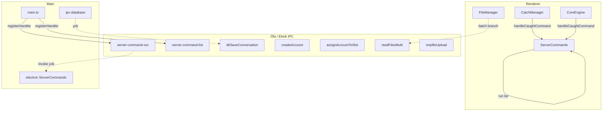

# Hayalet-ev Proje Analizi

## 1. Süreç ve Mantık Hataları

### 1.1 Hata mesajı tutarsızlığı
- **core-engine.ts** (satır 138, 440, 465): `getErrorMessage` yerine `(e instanceof Error ? e.message : String(e))` kullanılıyor. Proje genelinde `getErrorMessage` ([src/js/types/common.ts](src/js/types/common.ts)) standardı var.
- **command-manager.ts** (76-77, 210, 262): Aynı inline pattern; `getErrorMessage` import edilmiş ama bu satırlarda kullanılmamış.

### 1.2 Dokümante edilmiş ama implement edilmemiş IPC API’leri
- **dbSaveConversation**: [global.d.ts](src/js/global.d.ts) ve [AGENTS.md](AGENTS.md) içinde; `preload.cjs` ve [ipc-database.ts](electron/handlers/ipc-database.ts) içinde yok. `DatabaseManager` sadece `syncMessages` ile konuşma oluşturuyor; ayrı `saveConversation` yok.
- **createAccount / assignAccountToSlot**: global.d.ts ve AGENTS’da IPC olarak geçiyor; `preload.cjs` ve `ipc-settings.ts` içinde yok. Hesap oluşturma [account-panel.ts](src/js/pages/entrance/account-panel.ts) içinde `dbInitAccount` + `settingsManager.save` ile yapılıyor. Dokümantasyon yanıltıcı.

### 1.3 Ölü IPC handler’lar (Main)
- **server-command-run**, **server-command-list** ([main.ts](electron/main.ts) 290-291): `preload.cjs` bu kanalları expose etmiyor. Tüm komut akışı **renderer** [server-commands.ts](src/js/modules/server-commands.ts) üzerinden (CoreEngine.handleCaughtCommand → ServerCommands.run). Main’deki `ServerCommands.run` / `list` hiç çağrılmıyor.

### 1.4 Eksik / yanlış IPC ve dosya yolları
- **readFilesMulti**: [global.d.ts](src/js/global.d.ts) ve [file-manager.ts](src/js/modules/file-manager.ts) (65-76) batch yolunda kullanılıyor; `preload.cjs`’de yok. Electron ortamında `readFilesMulti` yok, batch dalı fiilen **ölü**; sadece fallback (app.ts `ensureElectronApiFallback`) devreye girer.
- **tmpfileUpload**: [global.d.ts](src/js/global.d.ts), [upload-manager.ts](src/js/modules/upload-manager.ts) TMPFILE servisi; preload ve main’de handler yok. `isServiceAvailable("TMPFILE")` her zaman false, `uploadMultipleFiles`’ta `ipcMethod` undefined olur.

### 1.5 Gereksiz / hatalı importlar (main)
- [main.ts](electron/main.ts): `writeStateSnapshot as _writeStateSnapshot` import edilmiş, `_writeStateSnapshot` kullanılmıyor.
- `openPath as _openPath` (file-manager’dan) import edilmiş; `open-path` handler’ı [ipc-fs.ts](electron/handlers/ipc-fs.ts) kendi `openPath` importu ile kullanıyor. main’deki `_openPath` kullanılmıyor.

### 1.6 İsimlendirme / yerleşim
- [electron/webview-manager.ts](electron/webview-manager.ts): İçerik sadece `catboxUpload` ve `uguuUpload`. “webview-manager” adı yanıltıcı; `upload-handlers.ts` veya `ipc-upload.ts` benzeri isim daha uygun.

### 1.7 Eksik `commands/` alt modülleri (kritik)
- [server-commands.ts](src/js/modules/server-commands.ts) şunları import ediyor:
  - `./commands/utils.js`, `./commands/device-commands.js`, `./commands/screenshot-commands.js`, `./commands/window-commands.js`, `./commands/whisper-commands.js`, `./commands/file-commands.js`, `./commands/ai-chat-commands.js`
- `src/js/modules/commands/` klasörü ve bu dosyalar **yok**. Build (Vite/ESBuild) bu import’lar yüzünden hata verir. Architecture/cache’te referans var, implement eksik.

### 1.8 Cleanup sırası
- `performCleanup` `window-all-closed`, `will-quit`, `before-quit` içinde çağrılıyor; `cleanupDone` ile idempotent. `before-quit` → `will-quit` sırası platforma göre farklı davranabilir; mevcut yapı çalışıyor ancak Electron doc’a göre `before-quit` tek ve net “son cleanup” noktası olarak düşünülebilir.

---

## 2. Merkezileştirilebilecek Fonksiyonlar

### 2.1 `getErrorMessage`
- **Renderer**: 20+ yerde [getErrorMessage](src/js/types/common.ts) kullanılıyor; core-engine ve command-manager’da 5+ yerde inline `(e instanceof Error ? e.message : String(e))` / `err instanceof Error ? err.message : String(err)`.
- **Öneri**: Tüm renderer catch bloklarında `getErrorMessage` kullan; core-engine ve command-manager’daki inline’ları kaldır.

### 2.2 Electron tarafında hata mesajı
- **electron**: `(err as Error)?.message || String(err)` pattern’i database/index, ipc-helpers, file-manager, webview-manager, server-commands, settings-manager vb. birçok yerde.
- **Öneri**: `electron/utils/error.ts` veya `electron/types` içine `getErrorMessage(error: unknown): string` ekle; main ve handler’larda bunu kullan. (Electron, `src/js/types`’a doğrudan bağımlı olmak zorunda değil.)

### 2.3 `deepClone` / `JSON.parse(JSON.stringify)`
- **settings-manager.ts** (15): `deepClone<T>(obj): T` = `obj ? JSON.parse(JSON.stringify(obj)) : obj`
- **core-engine.ts** (167, 175): `JSON.parse(JSON.stringify(settings))`
- **command-manager.ts** (128, 134): `sanitizePayload` içinde `JSON.parse(JSON.stringify(rest))` ve value bazlı aynı işlem.
- **settings-schema.ts** (72-73): `JSON.parse(JSON.stringify(defaults))`
- **Öneri**: `src/js/utils/clone.ts` veya `types/common`’a `deepClone<T>(obj: T): T` ekleyip bu yerlerde kullan. (Date/Map/Set/function taşınmaz; sadece JSON-safe objeler için açıkça belirt.)

### 2.4 `catboxUpload` / `uguuUpload` multipart yapısı
- [electron/webview-manager.ts](electron/webview-manager.ts): İki fonksiyon neredeyse aynı multipart mantığı (boundary, `Buffer.concat`, `fetch`). Sadece URL, form field adı (`fileToUpload` vs `files[]`) ve `post` kısmı farklı.
- **Öneri**: `buildMultipartUpload(url, { fileFieldName, extraFields }, { name, mimeType, base64 })` benzeri ortak helper; `catboxUpload` ve `uguuUpload` bunu kullansın.

---

## 3. Ölü Kodlar ve Fonksiyonlar

### 3.1 IPC / Preload
| Öğe | Konum | Durum |
|-----|-------|-------|
| `server-command-run` | main.ts handler | Preload’ta invoke yok; kullanılmıyor |
| `server-command-list` | main.ts handler | Preload’ta invoke yok; kullanılmıyor |
| `createAccount` (IPC) | global.d.ts, AGENTS | Preload/handler yok; hesap oluşturma panel’de lokal |
| `assignAccountToSlot` (IPC) | global.d.ts, AGENTS | Preload/handler yok; hiçbir yerde kullanılmıyor |
| `dbSaveConversation` | global.d.ts, AGENTS | Preload/handler yok |
| `readFilesMulti` | global.d.ts, file-manager | Preload’ta yok; Electron’da batch path ölü |
| `tmpfileUpload` | global.d.ts, upload-manager | Preload/handler yok |

### 3.2 Import / değişken
| Öğe | Konum | Durum |
|-----|-------|-------|
| `_writeStateSnapshot` | main.ts | Import var, kullanılmıyor |
| `_openPath` | main.ts | Import var, kullanılmıyor |
| `_sessionId` | main.ts (91) | `initLogSystem()` atanıyor, kullanılmıyor |

### 3.3 Dal / branch
- **FileManager.readUploadFiles**: `window.electronAPI?.readFilesMulti` kontrolü Electron’da hep falsy; sadece `for` döngüsü (sequential) çalışıyor. Batch branch ölü.

### 3.4 Electron `ServerCommands`
- `electron/server-commands.ts` içindeki `run` ve `list` yalnızca `server-command-run` / `server-command-list` handler’larından çağrılıyor. Bu handler’lar invoke edilmediği için bu kod path’i ölü.

---

## 4. Geliştirme Önerileri

### 4.1 IPC ve dokümantasyon tutarlılığı
- **global.d.ts** ve **AGENTS.md**: Sadece gerçekten preload + main’de implement edilmiş API’leri listele.
- **dbSaveConversation**: Ya `DatabaseManager.saveConversation` + `db-save-conversation` handler + preload ekle, ya da tipi ve AGENTS’taki satırı kaldır.
- **createAccount / assignAccountToSlot**: IPC olarak kullanılmayacaksa tipleri ve AGENTS’ı güncelle; “hesap oluşturma settings + dbInitAccount ile yapılır” notu ekle.

### 4.2 Eksik implementasyonlar
- **readFilesMulti**: Batch okuma ihtiyacı varsa: `electron/file-manager` veya handlers’a `read-files-multi` (paths → `{ path, data }[]`), preload’a `readFilesMulti` ekle; FileManager’daki batch dalını canlandır.
- **tmpfileUpload**: tmpfile.cc (veya kullanılan servis) için main’de handler + preload ekle; ya da UploadManager’dan TMPFILE’ı çıkarıp `isServiceAvailable`/dokümantasyonda “şu an desteklenmiyor” yaz.

### 4.3 commands/ modülleri
- **Seçenek A**: `src/js/modules/commands/` altında `utils`, `device-commands`, `screenshot-commands`, `window-commands`, `whisper-commands`, `file-commands`, `ai-chat-commands` oluştur; mevcut server-commands import’larını doğrula (`.js`→`.ts` uyumu, barrel export vb.).
- **Seçenek B**: Bu handler’ları [server-commands.ts](src/js/modules/server-commands.ts) içine inline veya aynı dosyada fonksiyon olarak toplayıp `commands/` import’larını kaldır. (Mimari dokümana göre modüler tercih A’ya daha uygun.)

### 4.4 Main process sadeleştirme
- `_writeStateSnapshot` ve `_openPath` import’larını kaldır.
- Kullanılmayan `_sessionId`’yi kaldır veya log/session tanımlayıcı olarak kullan.
- **server-command-run** / **server-command-list**: Renderer’da main’e taşınacak bir ihtiyaç yoksa, main’deki handler’ları ve electron `ServerCommands`’ın sadece bu IPC’ye hizmet eden kısmını kaldırmayı değerlendir; `ServerCommands` başka yerlerde (ör. doğrudan main içi) kullanılıyorsa sadece bu iki handler’ı kaldır.

### 4.5 Hata ve yardımcı katmanları
- Renderer: Tüm `(e instanceof Error ? e.message : String(e))` türevlerini `getErrorMessage` ile değiştir.
- Electron: Paylaşılan `getErrorMessage` (electron utils veya types) + database, ipc-helpers, file-manager, webview-manager, server-commands’ta kullanım.

### 4.6 Upload ve dosya
- `electron/webview-manager.ts`: İsmi `upload-handlers.ts` veya `ipc-upload.ts` yap; ya da sadece `catbox`/`uguu` export’larını `handlers/ipc-fs` veya yeni `ipc-upload`’a taşı.
- catbox/uguu için ortak multipart helper; kod tekrarını azalt.

### 4.7 `deepClone` ve `sanitizePayload`
- Ortak `deepClone` tanımı (JSON-safe, dokümante sınırlarla); settings-manager, core-engine, settings-schema’da kullan.
- `command-manager.sanitizePayload`: Mümkünse ortak `deepClone` veya “JSON-serializable copy” helper’a yönlendir; karmaşık try/parse kısmı aynı kalabilir.

### 4.8 Cleanup
- `performCleanup`’ın yalnızca `before-quit` (ve gerekirse `window-all-closed`) üzerinden çağrılması; `will-quit` ile çakışmayı azaltır. `cleanupDone` korunmalı.

---

## 5. Özet Diyagram

---

## 6. Öncelik Sırası

1. **Kritik (build/sağlık)**: `commands/` modüllerini oluştur veya server-commands import’larını kaldırıp handler’ları tek yerde topla.
2. **Yüksek**: global.d.ts / AGENTS ile preload+handler uyumunu sağla; ölü IPC’leri ve yanıltıcı doc’u temizle.
3. **Orta**: `getErrorMessage` (renderer + electron) ve `deepClone` merkezileştirme; gereksiz main import’larını kaldır.
4. **Düşük**: catbox/uguu multipart helper; `webview-manager` isim/konum; tmpfileUpload implement veya kaldırma; readFilesMulti batch implement; cleanup event sadeleştirme.
