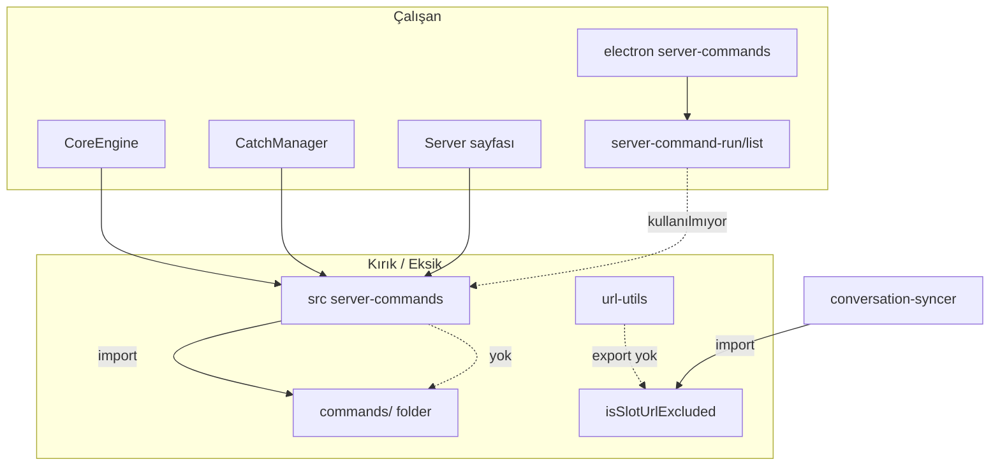

# Hayalet-ev (juu) Proje Analizi

## 1. Kritik Hatalar (Süreç ve Mantık)

### 1.1 Kırık Import: `src/js/modules/server-commands.ts`

[`src/js/modules/server-commands.ts`](src/js/modules/server-commands.ts) şu modülleri import ediyor:

- `./commands/utils.js` (createDefaultHandler)
- `./commands/device-commands.js` (deviceManagerHandler)
- `./commands/screenshot-commands.js`, `./commands/window-commands.js`, `./commands/whisper-commands.js`, `./commands/file-commands.js`, `./commands/ai-chat-commands.js`

**`src/js/modules/commands/` klasörü bu worktree'de yok.** CoreEngine, CatchManager ve Server sayfası bu modülü yüklediği için uygulama ilk yüklemede (veya server/entrance sayfasına geçişte) modül çözümleme hatası verecektir.

**Öneri:** Ya `commands/` alt modülleri (utils, device-commands, screenshot-commands, vb.) oluşturulmalı ya da `server-commands` tamamen **electron** tarafındaki `ServerCommands` ile değiştirilip tüm `ServerCommands.run` / `ServerCommands.list` çağrıları `window.electronAPI` IPC kanalları (`server-command-run`, `server-command-list`) üzerinden yapılmalı.

---

### 1.2 Eksik Export: `isSlotUrlExcluded`

[`src/js/modules/webview/conversation-syncer.ts`](src/js/modules/webview/conversation-syncer.ts) satır 19:

```ts
import { normalizeUrl, isSlotUrlExcluded, isDefaultPage } from "./methods/shared/url-utils.js";
```

[`src/js/modules/webview/methods/shared/url-utils.ts`](src/js/modules/webview/methods/shared/url-utils.ts) sadece `normalizeUrl`, `isDefaultPage`, `isUrlExcluded` export ediyor; **`isSlotUrlExcluded` yok.** Bu import çalışma zamanında hata verir.

`isSlotUrlExcluded(providerSlot, url)` muhtemelen slot → providerId (AppState / settings) → `ProviderRegistry.get(providerId).excludedUrls` → `isUrlExcluded(url, excludedUrls)` zincirini uygulayacak. [url-handler.ts](src/js/modules/slot/url-handler.ts) içindeki `checkUrlExclusion(slotState, url)` benzeri mantık, slot + url alacak şekilde `url-utils` içine taşınabilir.

**Öneri:** `url-utils.ts` içine `isSlotUrlExcluded(providerSlot: string, url: string): boolean` ekleyin; AppState/ProviderRegistry ile slot → providerId → `excludedUrls` çözümlemesi yapıp `isUrlExcluded` çağırın.

---

### 1.3 Dokümante Edilip Projede Olmayan Modüller

| Modül | AGENTS.md / .rovodev | Proje Dosyası |

|-------|----------------------|---------------|

| `ipc-client.ts` | "Type-safe IPC wrapper (`IPC.invoke()`)" | **Yok** |

| `error-boundary.ts` | "Global hata yakalama" | **Yok** |

`window.electronAPI` doğrudan 97+ yerde kullanılıyor; `IPC.invoke` veya `ipc-client` kullanılmıyor. ErrorBoundary hiç import edilmiyor.

**Öneri:** AGENTS.md ve .rovodev dokümanlarını güncelleyin: `ipc-client` ve `error-boundary` referanslarını kaldırın veya “planlanan” olarak işaretleyin. İleride type-safe IPC veya global hata sınırı ekleyecekseniz, bu modüllerin eklenmesiyle dokümantasyonu senkron tutun.

---

## 2. Merkezileştirilebilecek Fonksiyonlar

### 2.1 Base64 / Binary Dönüşümleri

Aynı mantık 5 yerde tekrarlanıyor:

| Konum | Amaç |

|-------|------|

| [`constants/file-utils.ts`](src/js/constants/file-utils.ts) | `decodeBase64` → UTF-8 string |

| [`webview/methods/file/dragdrop.ts`](src/js/modules/webview/methods/file/dragdrop.ts) | `base64ToUint8` (inline) → Uint8Array |

| [`webview/methods/file/injection.ts`](src/js/modules/webview/methods/file/injection.ts) | `base64ToUint8` (inline) |

| [`relay/ai-asistan-relay.ts`](src/js/modules/relay/ai-asistan-relay.ts) | `atob` + Uint8Array benzeri |

| [`analyze/draft-manager.ts`](src/js/pages/analyze/draft-manager.ts) | `atob` + TextDecoder |

**Öneri:** `constants/file-utils.ts` (veya `webview/methods/shared/file-utils.ts`) içine:

- `base64ToUint8Array(base64: string): Uint8Array` (atob + byte array)
- `decodeBase64` zaten var; gerekirse `base64ToUtf8` alias eklenebilir.

Dragdrop ve injection bu tek fonksiyonu kullansın. ai-asistan-relay ve draft-manager da aynı yardımcıyı import etsin.

---

### 2.2 Scraper: `normalizeText` ve `hashString` (djb2)

ChatGPT, Gemini, Grok scrapelerinde birebir aynı yardımcılar var:

- `normalizeText(str)`: `\r\n`/`\r` → `\n`, `[\t ]+ `→ ` `, ` *\n *` → `\n`, `\n{3,}` → `\n\n`, `trim`.
- `hashString(str)`: normalize sonrası djb2, `hash >>> 0`, `toString(16)`.

[`electron/database/hash-utils.ts`](electron/database/hash-utils.ts) aynı `normalizeText` ve `hashString` içeriyor; fakat scraper’lar **webview içinde** `executeJavaScript((scraper.toString())())` ile çalıştığı için renderer/electron modülü import edemiyor.

**Öneri (pratik):** Scraper’ların inject ettiği script tek bir string template’den üretilsin. Bu template içinde `normalizeText` ve `hashString` ortak bir blok olarak inline edilsin; kaynak tek yerden gelir, kopyala-yapıştır azalır. Örnek:

- `webview/providers/shared/scraper-helpers.ts` (veya .js): `export const SCRAPER_NORMALIZE_AND_HASH_SOURCE = "function normalizeText(str){...} function hashString(str){...}"` (string).
- Her scraper bu stringi kendi script’ine ekleyip `scrapeMessages`’ı onun üzerine inşa etsin.

Alternatif: Build aşamasında `hash-utils`’i IIFE olarak bundle’layıp webview’a enjekte etmek; bu daha büyük mimari değişiklik.

---

### 2.3 İki `waitForDomReady` İmplementasyonu

- **[`app.ts`](src/js/app.ts):** `waitForDomReady(webview)` – `dom-ready` once; basit.
- **[`slot/webview-handler.ts`](src/js/modules/slot/webview-handler.ts):** `waitForDomReady(slotState, slot, correlationId, logFn)` – timeout, `did-fail-load`, `_pendingLoad` vb.

Farklı imzalar ve kullanım yerleri (syncer, message-sender, file dragdrop/injection vs. slot-controller) var. Tam birleştirme yerine:

**Öneri:** Ortak bir “core” fonksiyon: `waitForDomReadyCore(webview, options?: { timeout?: number, onTimeout?: () => void })` → `dom-ready` veya timeout. `app.ts`’deki sadece bunu çağırır. `webview-handler`’daki, `slotState`/log/timeout/fail-load mantığını koruyup sonunda `waitForDomReadyCore`’u kullanacak şekilde refactor edilebilir. Böylece “dom-ready bekle” mantığı tek yerde toplanır.

---

## 3. Ölü / Tutarsız Kod ve Referanslar

### 3.1 `commands/` Klasörü ve server-commands

- `src/js/modules/commands/` yok; `server-commands` buradan import yapıyor → **ölü/ kırık import** (yukarıda 1.1’de ele alındı).

### 3.2 IPC: `server-command-run` / `server-command-list` Kullanılmıyor

- **Electron** `server-command-run` ve `server-command-list` kayıtlı ([`main.ts`](electron/main.ts) ~290).
- **Renderer** tarafında `ServerCommands.run` / `list` doğrudan `src/js/modules/server-commands` üzerinden çağrılıyor; **`window.electronAPI` ile bu IPC’ler kullanılmıyor.**

Sonuç: Main’deki `ServerCommands` (device, screenshot, whisper, window, vb.) fiilen **kullanılmıyor**; renderer tarafı kendi (şu an kırık) `server-commands`’a gidiyor.

**Öneri:** Renderer’ı electron’a bağlamak: `ServerCommands.run` → `window.electronAPI?.invoke?.('server-command-run', commandName, payload)` ve `ServerCommands.list` → `window.electronAPI?.invoke?.('server-command-list')`. Bu durumda `src/js/modules/commands/*` ve `src` içindeki `server-commands` handler’ları (device, screenshot, window, whisper, ai-chat, file, meta) kaldırılabilir; sadece `list`/`run`’ı IPC’e delegate eden ince bir façade kalır. Meta komutlar zaten `meta-define-command` vb. ile main’de; list’e Meta komutlarının eklenmesi main `COMMAND_LIST` ile uyumlu hale getirilebilir.

### 3.3 COMMAND_LIST Uyumsuzluğu

- **Electron** [`server-commands.ts`](electron/server-commands.ts): `DeviceManager`, `FileManager`, …, `AIAIChatStart`, `AIAIChatStop`, `GetFile`, `GetItDone`, `ListFiles` (AIAsistanChatStart/Stop ve DefineCommand/DeleteCommand/ListCustomCommands yok).
- **Renderer** [`server-commands.ts`](src/js/modules/server-commands.ts): Yukarıdakilere ek olarak `AIAsistanChatStart`, `AIAsistanChatStop`, `DefineCommand`, `DeleteCommand`, `ListCustomCommands`.

Tek referans noktası olarak electron’ın `COMMAND_LIST`’i alınırsa, UI’daki `ServerCommands.list()` bu listeden + meta komut isimleri (main’den veya ayrı bir `meta-list-commands` çağrısından) beslenmeli.

---

## 4. Diğer Tutarsızlıklar ve Küçük İyileştirmeler

### 4.1 İki `file-utils` (Farklı Amaçlar, İsimlendirme)

- `src/js/constants/file-utils.ts`: `getExtension`, `getFilename`, `getMimeType`, `getMimeTypeFromPath`, `generateUniqueId`, `sanitizeEmail`, `generateAccountId`, `getAccountDataPath`, `decodeBase64`.
- `src/js/modules/webview/methods/shared/file-utils.ts`: `validateFiles`, `formatUploadResponse`, `createErrorResponse` (yük doğrulama/ cevap formatı).

Amaçlar ayrı; sadece isim çakışması ve “file-utils” dağınıklığı var. **Öneri:** Upload tarafını `upload-utils.ts` veya `file-upload-utils.ts` yapın; `file-utils` genel dosya/ yol/ MIME tarafına kalsın.

### 4.2 `getErrorMessage`

[`src/js/types/common.ts`](src/js/types/common.ts) içinde merkezi; birçok modül `getErrorMessage` kullanıyor. Bu kısım iyi; dokümante edilmesi faydalı olur.

### 4.3 Database `{ success, data }` Kullanımı

AGENTS.md’de belirtildiği gibi `result?.data` kullanımı (örn. `message-renderer.ts`, `conversation-store`, `message-store`) tutarlı. Ek kullanımlarda aynı kalıbın kullanıldığından emin olun.

### 4.4 URL / Excluded Kontrolü İsimleri

- `url-utils`: `isUrlExcluded(url, excludedUrls)`.
- `url-handler`: `checkUrlExcluded` = `isUrlExcluded` (alias); `checkUrlExclusion(slotState, url)` ise `slotState.providerConfig.excludedUrls` ile `isUrlExcluded`’ı çağırıyor.

`isSlotUrlExcluded` eklendiğinde, `checkUrlExclusion` ile aynı mantığı slot+url ile kullanacak. İsimlendirme: `isUrlExcluded` (ham), `isSlotUrlExcluded` (slot’tan config çözümleyen) net kalır.

---

## 5. Mimari ve İyileştirme Önerileri

### 5.1 IPC Katmanı

- `window.electronAPI` 97+ yerde doğrudan kullanılıyor; tip güvenliği ve hata/ timeout yönetimi dağınık.
- **Öneri:** İnce bir `IPC` veya `ipc-client` modülü: `invoke<T>(channel, ...args): Promise<T>`, `handleMissing`, ortak try/catch ve isteğe bağlı timeout. Mevcut `electronAPI` çağrıları zamanla bu katmandan geçirilebilir; AGENTS.md’deki “ipc-client” burada anlam kazanır.

### 5.2 ServerCommands Tekilleştirme

- **Main** (electron): device, screenshot, whisper, window, listfiles, restart; `_mainWindow` ve fiziksel işlemler.
- **Renderer** (src): Aynı isimli komutlar + AIAsistan, Meta; fakat `./commands/*` olmadığı için kırık.

**Öneri:** “Bir komut listesi, tek execution yeri”:

1. Tüm gerçek komutlar **main**’de (electron `server-commands` + gerekirse meta).
2. Renderer’da yalnızca: `ServerCommands.run` → `server-command-run` IPC, `ServerCommands.list` → `server-command-list` (ve gerekirse meta listesi). `./commands/*` ve handler map kaldırılır.
3. `COMMAND_LIST` sadece main’de; AIAsistan ve Meta komutları main’e taşınmamışsa, main’in list’ine eklenir veya `server-command-list` meta + temel listeyi birleştirip döner.

### 5.3 Scraper Ortak Yapı

- ChatGPT, Gemini, Grok: `normalizeText`, `hashString`, preferred/fallback selector, role atama, img alt, `contentHash`/`domIndex` benzeri.
- OpenCode: Farklı DOM; `contentHash`/`domIndex` yok.

**Öneri:** Soyut bir “config-driven” scraper: config’te `scrapeSelectors`, `roleSelectors`, `messageIdSelector` vb. tanımlı; ortak döngü (node listesi, role çıkar, metin, hash, domId) tek yerde. Provider’lar sadece config + küçük provider-spesifik sapmalar (Grok’taki `hasUserBorder`/`isFullWidth` gibi) verir. Bu, selector değişikliklerinde tek noktadan güncellemeyi kolaylaştırır.

### 5.4 `hash-utils` Kullanımı

- **electron/database**: `normalizeText`, `hashString` (sync/DB tarafı).
- **Scraper’lar**: Aynı algoritma, webview içinde string olarak.

Ortak “kaynak” (ör. `scraper-helpers` string veya build’le enjekte IIFE) ile hem DB hash’i hem scraper hash’i aynı normalizasyon ve djb2’ye dayanabilir; bu da DB ↔ scraper uyumunu artırır.

### 5.5 Hata Yönetimi ve ErrorBoundary

- `getErrorMessage` yaygın ve tutarlı kullanılıyor.
- **ErrorBoundary:** AGENTS.md’de var, kodda yok. React/ benzeri ağaç kullanılmıyorsa “ErrorBoundary” daha çok “global unhandled rejection / error listener” anlamına gelebilir.

**Öneri:** `window.onerror` / `unhandledrejection` için merkezi bir modül (örn. `error-boundary.ts` veya `global-error-handler.ts`) ekleyip log + isteğe bağlı kullanıcı bildirimi yapın. AGENTS.md’deki “ErrorBoundary” buna göre güncellenir.

### 5.6 Test ve CI

- `npm run check` / `npm run lint` / `npm run check-types` çalıştığında, `server-commands`’ın `./commands/*` import’ları ve `isSlotUrlExcluded` import’u **derleme/analiz aşamasında** hata vermeli. Bu hataların giderilmesi, refactor (IPC’e geçiş, `isSlotUrlExcluded` ekleme, `commands/` kaldırma) ile birlikte yapılmalı.

---

## 6. Özet Aksiyon Listesi

| Öncelik | Aksiyon |

|---------|---------|

| P0 | `src/js/modules/server-commands` import’larını düzelt: ya `commands/` oluştur ya da `run`/`list`’i IPC’e (`server-command-run`, `server-command-list`) taşı ve `./commands/*` handler’larını kaldır. |

| P0 | `url-utils.ts`’e `isSlotUrlExcluded(providerSlot, url)` ekle; conversation-syncer import’unu çalışır hale getir. |

| P1 | AGENTS.md ve .rovodev’ten `ipc-client`, `error-boundary` referanslarını güncelle veya “planlanan” yap. |

| P1 | `base64ToUint8Array` (ve gerekirse `decodeBase64` kullanımı) tek yerde topla; dragdrop, injection, ai-asistan-relay, draft-manager’ı buna bağla. |

| P2 | Scraper’lar için ortak `normalizeText`/`hashString` kaynağı (string template veya build); `hash-utils` ile uyum. |

| P2 | `waitForDomReady` için ortak `waitForDomReadyCore`; app ve webview-handler bunu kullansın. |

| P2 | `file-utils` (upload) → `upload-utils` veya `file-upload-utils` olarak ayır. |

| P2 | COMMAND_LIST’i tek yerde (main) topla; renderer `ServerCommands` sadece IPC façade. |

| P3 | İnce bir `ipc-client` / IPC wrapper ve kademeli `electronAPI` geçişi. |

| P3 | Global `onerror`/`unhandledrejection` modülü ve AGENTS.md’de ErrorBoundary’nin buna göre tanımı. |

---

## 7. Bağımlılık / Akış Özeti



---

*Analiz [juu](.) worktree’sine göre yapıldı. `commands/` veya `isSlotUrlExcluded` ana repoda farklıysa, burada anlatılanlar juu’ya özeldir.*