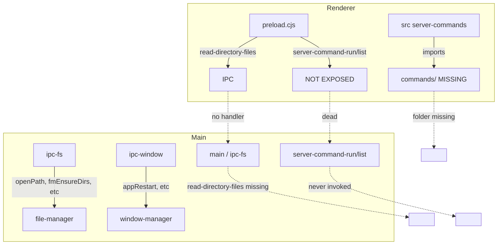

# Hayalet-ev Proje Analizi

## 1. Süreç ve Mantık Hataları

### 1.1 Eksik / Kırık IPC ve Modüller

| Sorun | Konum | Açıklama |

|-------|-------|----------|

| **read-directory-files handler yok** | `electron/` | [preload.cjs](electron/preload.cjs) ve [webview-preload.cjs](electron/webview-preload.cjs) `readDirectoryFiles` → `read-directory-files` expose ediyor; `main.ts` ve [ipc-fs.ts](electron/handlers/ipc-fs.ts) bu kanal için handler kaydetmiyor. Çağrı timeout veya "No handler" hatasına yol açar. |

| **commands/ modülü eksik** | `src/js/modules/` | [server-commands.ts](src/js/modules/server-commands.ts) şunları import ediyor: `./commands/utils.js`, `./commands/device-commands.js`, `./commands/screenshot-commands.js`, `./commands/window-commands.js`, `./commands/whisper-commands.js`, `./commands/file-commands.js`, `./commands/ai-chat-commands.js`. `src/js/modules/commands/` klasörü bu worktree’de yok. Build veya çalışma zamanı import hatası riski. |

### 1.2 main.ts Import ve Cleanup Mantığı

- **Gereksiz / ölü importlar** ([main.ts](electron/main.ts)):
  - `ipcMain as _ipcMain` — kullanılmıyor (handler’lar `registerHandler` ile; `ipcMain` doğrudan kullanılmıyor).
  - `openPath as _openPath` — `openPath` [ipc-fs.ts](electron/handlers/ipc-fs.ts) üzerinden `file-manager`’dan alınıyor; main’deki import kullanılmıyor.
  - `appRestart as _appRestart` — [ipc-window.ts](electron/handlers/ipc-window.ts) `appRestart`’ı doğrudan `window-manager`’dan alıyor; main’deki import kullanılmıyor.
  - `writeStateSnapshot as _writeStateSnapshot` — sadece `writeStateSnapshot` kullanılıyor; ikinci (alias) import gereksiz.
- **performCleanup** `before-quit`, `will-quit` ve `window-all-closed`’da çağrılıyor. `cleanupDone` ile çift çalışma engellenmiş; mantık doğru. `writeSessionSummary(0,0,0,0,"normal")` sabit argümanlar — gerçek sayılar (toplam log, hata, uyarı, chunk) kullanılmıyorsa anlam kaybı olabilir.

### 1.3 Log / Dokümantasyon Tutarsızlığı

- [AGENTS.md](AGENTS.md) ve [logging.md](.rovodev/logging.md): Ana log dosyası için farklı vurgu: AGENTS "`console-001.log` birleşik log", logging "`structured.jsonl` asıl log". Hangi dosyanın “tek kaynak” olduğu netleştirilmeli.
- [context.md](.rovodev/context.md): "Uncommitted: Yok" ve "src/js/modules/: 0 dosya" gibi bilgiler güncel değil; `bootstrap`/cache’in yeniden üretilmesi gerekebilir.

---

## 2. Merkezileştirilebilecek Fonksiyonlar

### 2.1 Hata Mesajı: `getErrorMessage` vs inline

[getErrorMessage](src/js/types/common.ts) `src/js/types/common.ts`’te tanımlı. Buna rağmen birçok yerde şu kalıp tekrarlanıyor:

```ts
err instanceof Error ? err.message : String(err)
// veya (e as Error)?.message
```

Örnekler: [core-engine.ts](src/js/modules/core-engine.ts) (181, 398), [command-manager.ts](src/js/modules/command-manager.ts) (76, 210, 262), [googledrive.ts](src/js/modules/webview/methods/file/googledrive.ts) (40), [uguu.ts](src/js/modules/webview/methods/file/uguu.ts) (37), [tmpfile.ts](src/js/modules/webview/methods/file/tmpfile.ts) (40), [catbox.ts](src/js/modules/webview/methods/file/catbox.ts) (40), [injection.ts](src/js/modules/webview/methods/message/injection.ts) (172), [xdotools.ts](src/js/modules/webview/methods/message/xdotools.ts) (42), [conversation-syncer.ts](src/js/modules/webview/conversation-syncer.ts) (363), [upload-manager.ts](src/js/modules/upload-manager.ts) (112), [catch-manager.ts](src/js/modules/catch-manager.ts) (92), [command-executor.ts](src/js/modules/command-executor.ts) (127), [opencode-event-parser.ts](electron/opencode-event-parser.ts) (130). Ayrıca `electron/` tarafında `getErrorMessage` yok; `(err as Error)?.message` kullanımları (örn. [ipc-helpers](electron/handlers/ipc-helpers.ts), [main.ts](electron/main.ts), [webview-manager](electron/webview-manager.ts)) ayrı bir merkezi helper ile toplanabilir.

Öneri:

- Renderer: Tüm bu noktaları `getErrorMessage(err)` ile değiştir.
- Electron: `getErrorMessage` benzeri bir yardımcıyı `electron/` (veya paylaşılan bir `common`) altına taşıyıp `ipc-helpers`, `main`, `webview-manager`, `opencode-event-parser` vb. kullansın.

### 2.2 `isUrlExcluded` / `isSlotUrlExcluded` wrapper’ları

[url-utils.ts](src/js/modules/webview/methods/shared/url-utils.ts) `isSlotUrlExcluded` merkezi. Buna rağmen birçok modülde `@deprecated` wrapper var:

- [WebviewManager.isUrlExcluded](src/js/modules/webview-manager.ts) (194–200)
- [TrafficManager.isUrlExcluded](src/js/modules/traffic-manager.ts) (116–118)
- [ConversationSyncer.isUrlExcluded](src/js/modules/webview/conversation-syncer.ts) (127–130)
- [MessageSender.isUrlExcluded](src/js/modules/webview/message-sender.ts) (89–92)

Öneri: Tüm çağrıları `isSlotUrlExcluded(providerSlot, url)` doğrudan `url-utils`’ten kullanacak şekilde güncelle; bu dört wrapper’ı kaldır.

### 2.3 Catbox / Uguu multipart mantığı

[electron/webview-manager.ts](electron/webview-manager.ts) içindeki `catboxUpload` ve `uguuUpload` (boundary, `Buffer.concat`, `fetch` ile multipart) birbirine çok benzer. Ortak bir `uploadMultipart(url, formFields, fileBuffer, name, mimeType)` (veya benzeri) ile merkezileştirilebilir; sadece URL ve form alanları provider’a göre değişir.

---

## 3. Ölü Kod ve Kullanılmayan Yapılar

### 3.1 main.ts

- `_ipcMain`, `_openPath`, `_appRestart`, `_writeStateSnapshot`, `_sessionId`: Yukarıda belirtildi; kullanılmıyor, kaldırılabilir.

### 3.2 Electron ServerCommands IPC

- [main.ts](electron/main.ts): `server-command-run` ve `server-command-list` için `ServerCommands.run` / `ServerCommands.list` (electron [server-commands.ts](electron/server-commands.ts)) kayıtlı.
- Preload’da bu kanallar expose edilmiyor; renderer’dan `server-command-run` / `server-command-list` çağrılamıyor.
- Renderer tarafı [src/js/modules/server-commands.ts](src/js/modules/server-commands.ts) kendi `ServerCommands.run`/`list`’ini kullanıyor (IPC ile değil, doğrudan handler’lar ve `MetaCommandManager`). Sonuç: electron’daki `server-command-run` ve `server-command-list` handler’ları fiilen çağrılmıyor → ölü IPC.

Seçenekler: (a) Preload’a ekleyip renderer’ın tek noktadan (main) komut çalıştırmasını sağlamak, veya (b) Bu IPC’yi ve buna bağlı electron `ServerCommands` kullanımını kaldırmak. Mimari tercihe göre karar verilmeli.

### 3.3 `read-directory-files`

- Preload’da expose, main’de handler yok. Kimse çağırmıyorsa tamamen ölü; çağrılıyorsa runtime hatası. Kullanım yoksa preload’dan da kaldırılabilir; kullanım varsa `ipc-fs` veya `file-manager` tabanlı bir handler eklenmeli.

---

## 4. console.log / LogManager Uyumsuzluğu

[.rovodev/logging.md](.rovodev/logging.md) ve [AGENTS.md](AGENTS.md): Renderer’da `console.log`/`warn`/`error` yerine `LogManager` kullanılması isteniyor. Projede 300+ `console.*` kullanımı var; özellikle:

- `src/opencode-ui/` (JS): `session-store`, `normalizers`, `sse-client`, `message-renderer`, `store-bridge`, `message-store`, `app`, `api-client` vb. — hepsi `console.*` kullanıyor.
- `electron/`: `main`, `database/index`, `console-logger` (orijinalleri saklayıp yönlendirme), `opencode-sse-server`, `opencode-manager`, `opencode-event-parser`, `session-manager`, `settings-manager`, `window-manager`, `webview-preload`, `preload` — çoğu doğrudan `console.*`.
- `mcp-server/`: `progress`, `provider-config`, `mcp-logger`, `index`, `dev-tools` (örnek dokümantasyon) — `console.*`.

Öneri: Renderer (`src/js`) ve mümkünse `opencode-ui` için `console.*` → `LogManager` geçişi; electron ve mcp-server için ise “main/mcp’te console kabul edilebilir” gibi bir istisna netleştirilip, en azından kritik akışlarda ortak bir log arayüzüne (ör. `appendLog` / `console-logger`) yönlendirme düşünülebilir. Öncelik: `src/js` ve `src/opencode-ui`.

---

## 5. Önerilen Sistem İyileştirmeleri

### 5.1 IPC ve Modül Yapısı

- **read-directory-files**: Ya `ipc-fs` + `file-manager` ile handler eklenmeli ya da kullanım yoksa preload’dan çıkarılmalı.
- **commands/**: `src/js/modules/commands/` oluşturulup `device-commands`, `screenshot-commands`, `window-commands`, `file-commands`, `whisper-commands`, `ai-chat-commands`, `utils` implemente edilmeli; veya `server-commands` bu modüllere ihtiyaç duymayacak şekilde sadeleştirilip yeniden düzenlenmeli. Mevcut import’larla build alınamıyorsa bu acil.
- **server-command-run/list**: Mimariye göre ya preload + kullanım eklenmeli ya da main’deki handler’lar ve gereksiz `ServerCommands` init kaldırılmalı.

### 5.2 Hata ve Log

- Hata mesajı: Renderer + electron için tek `getErrorMessage` (veya eşdeğeri) kullanımı.
- `ipc-helpers` `handleIPC`: Hata dönüşü için `(err as Error).message` yerine merkezi `getErrorMessage` (electron’a uyarlanmış) kullanımı.
- Log: `console-001.log` vs `structured.jsonl` rolü AGENTS ve logging’de tek cümleyle netleştirilmeli.

### 5.3 Tip ve IPC Güvenliği

- [ipc-client.ts](src/js/modules/ipc-client.ts) type-safe IPC’yi sarmalıyor; kullanımın tüm kritik IPC çağrılarına yaygınlaştırılması faydalı.
- `global.d.ts` ve `ipc-channels.ts` ile preload’ın expose ettiği kanallar eşleştirilip, dokümante edilmemiş veya kullanılmayan API’ler işaretlenebilir.

### 5.4 Test ve Bakım

- `commands/` ve `read-directory-files` düzeltmesi sonrası `npm run check` ve `npm run build` ile derleme; `npm start` ile en azından giriş, server, asistan sayfalarının açıldığı smoke test.
- `error-patterns.ts` [log-manager](electron/log-manager.ts) ile kullanılıyor; mcp `debug-tools`’daki `matchErrorPattern` ile tekrarlanıyorsa, ortak bir modüle (veya electron’dan mcp’e paylaşılacak şekilde) taşınabilir.

### 5.5 Dokümantasyon ve Cache

- `context.md` ve `cache.json`: `npm run bootstrap` (veya ilgili script) güncel yapı ve “Uncommitted” bilgisiyle yeniden üretilmeli.
- AGENTS’daki “IPC üzerinden çağrılan modüller” listesi `read-directory-files`, `server-command-run/list` ve `commands/` durumuna göre güncellenmeli.

---

## 6. Özet Diyagram (Mevcut IPC / Modül Aksaklıkları)



---

## 7. Öncelik Sırası (Uygulama İçin)

1. **Kritik (build/çalışma):** `commands/` eksikliği ve `read-directory-files` handler’ı; main’deki gereksiz import’ların temizlenmesi.
2. **Yüksek:** Hata mesajı için `getErrorMessage` merkezileştirme; `isUrlExcluded` wrapper’larının kaldırılıp doğrudan `isSlotUrlExcluded` kullanımı.
3. **Orta:** `server-command-run`/`list` için mimari karar ve ölü kodun kaldırılması; `console.*` → `LogManager` (en azından `src/js`); catbox/uguu ortak multipart.
4. **Düşük:** Dokümantasyon (AGENTS, logging, context) ve cache güncellemesi; `writeSessionSummary` argümanlarının anlamlı değerlerle beslenmesi.