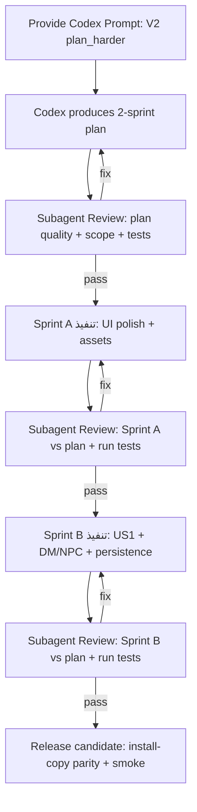

# Fate Knots (Card‑FRP) V2 — Two‑Sprint Plan for Hayalet Ev Game Room

## Executive summary

**Enabled connectors:** `github` (only).  

Your repo already contains a **working V1 “Fate Knots” skeleton** that is fully registered as a third `game-room` feature (alongside XOX and Team Tetris) via the **room manifest** and the **room host command registry**. fileciteturn46file0L1-L1 fileciteturn47file0L1-L1  
The current Fate Knots runtime is deterministic and stable: **lobby → character creation → scenario (unanimous decision) → combat → result**, with AI seats responding via strict single‑line `++cmd:GameRoomFateKnots*` commands. fileciteturn49file0L1-L1 fileciteturn35file0L1-L1  
V2 should focus on two priorities: **(A) UI polish + asset finalization** (bring the renderer in line with your strict “scene-first / not a web dashboard” rules), and **(B) feature expansion** (remote US1 participation, AI DM/NPC protocols, and “persistence” as run history + player profile, with a clear path to full save/resume later). fileciteturn25file0L1-L1 fileciteturn51file0L1-L1  

## Repo analysis and V2 integration points

### What exists today (V1)

**Feature registration + entry points**
- `rooms/game-room/manifest.json` registers `fate-knots` with its view, command specs, and protocol specs. fileciteturn46file0L1-L1  
- `rooms/game-room/host/index.js` wires `GameRoomFateKnots*` commands to Fate Knots runtime handlers and dispatches pending work when the feature is active. fileciteturn47file0L1-L1  
- `rooms/game-room/ui/index.js` routes host messages of type `"fate-knots-state"` into the Fate Knots UI module and selects Fate Knots rendering when it’s the active feature. fileciteturn48file0L1-L1  

**Runtime engine (host)**
- The Fate Knots host runtime is in `rooms/game-room/main-functions/fate-knots/host/runtime.js`. It implements:
  - roster build for `user + ready AI seats`  
  - unanimous decision gate in scenario  
  - deterministic combat and turn ownership  
  - strict AI prompt dispatch (AI must output a single `++cmd:GameRoomFateKnotsAiChoice(...)` line or `AiCombatAction(...)`) fileciteturn49file0L1-L1  
- In V1, **US1 is explicitly excluded** from the run even if connected (“v1-remote-deferred”), and tests assert this. fileciteturn49file0L1-L1 fileciteturn44file0L1-L1  

**State serialization contract**
- Host-side serialization/push is implemented in `rooms/game-room/main-functions/fate-knots/host/state.js` via `api.notifyRoom("fate-knots-state", ...)`, and the UI consumes that shape. fileciteturn31file0L1-L1 fileciteturn48file0L1-L1  

**Content + assets pipeline**
- Fate Knots content and asset registry load from generated manifests (`runtime-content.module.js`) and normalize into a `contentRegistry` (assets, selections, map, scenario steps, combat cards/config). fileciteturn27file0L1-L1 fileciteturn28file0L1-L1  
- The portable asset bundle is produced by `scripts/rooms/sync-game-room-fate-knots-assets.mjs`, driven by `rooms/game-room/main-functions/fate-knots/data/asset-import.manifest.json`. fileciteturn39file0L1-L1 fileciteturn40file0L1-L1  

**UI and UI regression harness**
- Fate Knots UI module is `rooms/game-room/main-functions/fate-knots/ui/module.js` + `styles.css` (DOM/CSS renderer). fileciteturn53file0L1-L1  
- You already have a DOM-like regression harness that asserts stable hooks: `data-fk-phase`, `data-fk-role`, `data-seat-id`, and verifies commands are dispatched correctly per phase. fileciteturn53file0L1-L1  

### Key V2 takeaways from the repo

- **The command bridge is stable already**: the room host maps command names and the UI uses `window.roomAPI.sendCommand(...)` consistently. V2 should add new commands only when absolutely needed (DM narration packets / persistence). fileciteturn47file0L1-L1 fileciteturn48file0L1-L1  
- **US1 transport plumbing exists at the room level** through XOX’s mailbox sync and dispatch pathway (it already forwards commands for other features, including Fate Knots). This makes “US1 becomes a real voter/combatant” feasible in V2 without inventing a new transport layer—just add Fate Knots “prompt to US1” sends and stop excluding US1 from the roster. fileciteturn54file0L1-L1 fileciteturn49file0L1-L1  
- Your repo already contains a **Scene‑First UI plan doc** (generated 2026‑03‑27) that explicitly says: “DOM/CSS only, follow SVG wireframes closely, eliminate dashboard feel, add dormant 4-seat anchors without changing V1 logic.” That doc is the best “source of truth” for Sprint A. fileciteturn51file0L1-L1  

### File-to-responsibility map (V2 hotspots)

| Area | File(s) to change in V2 | Why it matters |
|---|---|---|
| Feature contract | `rooms/game-room/manifest.json` fileciteturn46file0L1-L1 | Add V2 commands/protocols if needed (DM/NPC/persistence) |
| Host command wiring | `rooms/game-room/host/index.js` fileciteturn47file0L1-L1 | Register new commands; keep switching behavior safe |
| Fate Knots engine | `rooms/game-room/main-functions/fate-knots/host/runtime.js` fileciteturn49file0L1-L1 | US1 roster inclusion, DM/NPC dispatch hooks, persistence writes |
| Snapshot schema | `rooms/game-room/main-functions/fate-knots/host/state.js` fileciteturn31file0L1-L1 | Add new fields (dmNarration, runHistory summary, etc.) safely |
| Combat system | `rooms/game-room/main-functions/fate-knots/host/combat-engine.js` fileciteturn29file0L1-L1 | Optional incremental RNG/dice or balance knobs |
| UI renderer | `rooms/game-room/main-functions/fate-knots/ui/module.js` + `styles.css` fileciteturn53file0L1-L1 | Scene-first polish, asset-backed primitives, interaction fixes |
| Asset pipeline | `scripts/rooms/sync-game-room-fate-knots-assets.mjs` + `asset-import.manifest.json` fileciteturn39file0L1-L1 fileciteturn40file0L1-L1 | Ensures portable runtime assets, eliminates drift |
| UI safety net | `scripts/tests/game-room-fate-knots-ui-path-regressions.test.ts` fileciteturn53file0L1-L1 | Update/extend assertions after UI refactor |
| Host safety net | `scripts/tests/game-room-fate-knots-host-regressions.test.ts` fileciteturn44file0L1-L1 | Update tests when US1 is no longer deferred; DM/NPC hooks |

## V2 objectives and scope

### Sprint A objectives (UI polish + asset finalization)
- **Deliver “scene-first” look/feel** that follows your repo’s UI rules (“not web app, no glassmorphism, no dashboard tiles”). fileciteturn25file0L1-L1  
- **Implement the core of the Scene‑First UI plan** in two weeks worth of work: replace generic CSS panels with asset-backed primitives, enforce stable DOM hooks, keep runtime contract unchanged. fileciteturn51file0L1-L1  
- **Asset pipeline sanity**: eliminate any remaining “drift” risks (missing assets, stale asset copies, inconsistent UI assets across phases) by tightening asset checks and ensuring installed-room parity gates are run. fileciteturn39file0L1-L1  

### Sprint B objectives (feature expansion: US1, AI/DM protocols, persistence)
- **US1 becomes a real participant** (vote + combat), stopping the explicit deferral. fileciteturn49file0L1-L1  
- **Add DM/NPC protocols** in a V2-safe way that does not destabilize the core engine:
  - DM as “narration/scene packet enrich” (not the combat resolver; combat stays engine-owned)  
  - NPC/companion as “banter and advice” (optional, can be toggled)  
  - Both remain strict `++cmd` responders, just like current AI decision/combat seats. fileciteturn35file0L1-L1 fileciteturn36file0L1-L1  
- **Persistence (V2 definition)**: at minimum, persist:
  - user “profile” (last used avatar/class/background)  
  - run history summary (outcome, timestamp, roster)  
  - optional “save slot” scaffold for full resume later.

## Two‑sprint plan with effort, acceptance criteria, and review checkpoints

The estimates below assume **1 senior dev** baseline. If you run multiple subagents in parallel, compress time accordingly.

### Sprint A — UI polish + asset finalization

**Goal:** Turn V1’s functional UI into the “scene-first” surface described in `fate-knots-scene-first-ui-plan.md`, without changing host/runtime payloads. fileciteturn51file0L1-L1  

| Task | Effort | What changes | Acceptance criteria |
|---|---:|---|---|
| A1. Lock UI contract + DOM landmarks | 0.5–1 day | Confirm/standardize `data-fk-phase`, `data-fk-role`, `data-seat-id` usage across all phases | UI regression harness remains stable and asserts the new layout roles per phase fileciteturn53file0L1-L1 |
| A2. Replace “dashboard panels” with asset-backed primitives | 2–4 days | Rework `styles.css` and UI module to rely on runtime assets (frames/buttons/dialogue/status) rather than generic blur/rounded panels | No “glass card” look; primary surfaces are framed; still clickable buttons; commands unchanged fileciteturn25file0L1-L1 |
| A3. Scene-first layout per phase (overview, creation, scenario, combat, result) | 3–5 days | Implement the core layout shifts described in the UI plan (dominant map/scene/combat arena; restrained supporting rails) | Each phase has one dominant “scene shell” region; no new scroll traps; tests updated to match layout fileciteturn51file0L1-L1 |
| A4. Asset preload to prevent “pop-in” | 0.5–1.5 days | Add a lightweight preloader for UI textures | First render does not flash missing images; no layout jump; memory stays bounded (evict or only preload UI family) citeturn2view0 |
| A5. Asset pipeline hardening + installed package parity | 1–2 days | Ensure `sync-game-room-fate-knots-assets.mjs` is part of the sprint flow; validate `asset-import.manifest.json` coverage; run installed-copy smoke gates | Running the sync script produces deterministic manifests; installed room can load Fate Knots view/assets successfully fileciteturn39file0L1-L1 fileciteturn40file0L1-L1 |
| A6. UI regression refresh | 1–2 days | Update `game-room-fate-knots-ui-path-regressions.test.ts` to assert new structure + keep command dispatch checks | All UI path tests pass; scroll preservation still passes; no new brittle selectors fileciteturn53file0L1-L1 |

**Sprint A subagent review checkpoints**
- **Pre-implementation review**: ensure “UI rules forbidding web-app look” are being enforced and not contradicted by new CSS decisions. fileciteturn25file0L1-L1  
- **Mid-sprint review** (after A2/A3): verify all new primitives remain **real `<button>`** for interactive controls and dummy seats remain non-focusable. fileciteturn51file0L1-L1  
- **Post-sprint review**: run UI + host regressions and confirm installed-copy parity is refreshed.

### Sprint B — Feature expansion: US1 participation, AI DM/NPC protocols, persistence

**Goal:** Extend gameplay without breaking V1 stability: remove US1 deferral, add “DM narration packets” (not DM combat), add persistence as profile + run history.

| Task | Effort | What changes | Acceptance criteria |
|---|---:|---|---|
| B1. Stop excluding US1 from roster | 1–2 days | Update `buildRunParticipants(...)` to include US1 when ready; update associated tests that currently assert `v1-remote-deferred` | Host reg tests updated; roster includes US1 in participantIds and unanimous decision set when ready fileciteturn49file0L1-L1 fileciteturn44file0L1-L1 |
| B2. Dispatch “decision prompts” to US1 via room mail | 2–4 days | Add `api.sendUs1Message` prompts for decision/combat turns where US1 is pending; reuse the same `++cmd` strictness described in the US1 transport protocol | Remote user receives clear step/choices + command template; US1 commands are accepted by host as `RemoteChoice` / `RemoteCombatAction` fileciteturn37file0L1-L1 fileciteturn46file0L1-L1 |
| B3. DM protocol: narration/enrichment packets | 2–4 days | Add DM prompt/response loop: AI1 (or a chosen seat) receives current step + last decision result and returns one `++cmd` line carrying a “narration packet” to be displayed (no hidden info leaks) | DM output displayed in UI; DM cannot alter core state transitions; host still owns scenario/combat progression fileciteturn35file0L1-L1 |
| B4. NPC/companion protocol: short “banter/advice” bubble | 1–3 days | AI2 (or chosen seat) can optionally send a quip/advice line as a single command; UI shows it as a temporary bubble above seat card | Bubble appears for correct seat; expires automatically; does not interfere with command parsing or decision logic |
| B5. Persistence v2: profile + run history | 2–4 days | Add durable state keys (e.g., `fate-knots-profile`, `fate-knots-history`), store last build + completed run summaries | After reset/exit, lobby shows recent runs; new run defaults to last selection unless user changes it |
| B6. Updated regression matrix | 2–4 days | Update host + UI regressions to cover “US1 included”, “DM packet stored”, “history persisted” | All relevant test suites pass and new V2 behavior has red/green checks fileciteturn44file0L1-L1 fileciteturn53file0L1-L1 |

**Sprint B subagent review checkpoints**
- **Security/knowledge boundary review** for DM/NPC prompts: DM may know more, but narration packets must not reveal secrets beyond current player-visible state.  
- **Protocol compliance review**: DM/NPC must output exactly **one** `++cmd:` line, like existing AI protocols. fileciteturn35file0L1-L1 fileciteturn36file0L1-L1  
- **Transport review**: US1 prompt dispatch should not spam messages; add dedupe keys and only send when a new pending state is entered.

## Codex-ready prompts for V2 implementation

These are written in the style you described: “plan_harder → sprint breakdown → subagent review → apply plan → review/fix until aligned.”

### High-level V2 plan prompt (Codex)

> You are implementing Fate Knots V2 in the repository `raistlinmajere1981-del/hayalet-ev`.  
> Use `plan_harder` to create a two-sprint plan:
> - Sprint A: UI polish + asset finalization (scene-first UI per `fate-knots-scene-first-ui-plan.md` and `assets/game-room-fate-knots-ui-rules.md`), **no host/runtime contract changes**.
> - Sprint B: feature expansion — US1 becomes a participant (no longer deferred), add DM + NPC protocols (single-line `++cmd:` responders), and persistence (profile + run history, optional save-slot scaffold).
>
> Constraints:
> - Treat `rooms/` as source-of-truth; keep `data/rooms/` in sync via your existing room packaging workflow.
> - Do not break XOX or Team Tetris.
> - Keep interactive controls as real `<button>` elements; dummy seats must remain non-focusable and non-interactive unless V2 explicitly enables them.
> - Do not add scenario story content; prompts must be generic and system-oriented.
> - Update regression tests: UI path regressions + host regressions + installed-copy smoke.
>
> Deliver:
> - a sprint plan with tasks, ordering, acceptance criteria, and expected code touchpoints;
> - a “subagent review” checklist before and after each sprint;
> - then implement Sprint A fully, run tests, fix until green;
> - then implement Sprint B fully, run tests, fix until green.

### Sprint A execution prompt (Codex)

> Implement Sprint A (UI polish + asset finalization).  
> Required references:
> - `fate-knots-scene-first-ui-plan.md`
> - `assets/game-room-fate-knots-ui-rules.md`
> - `scripts/tests/game-room-fate-knots-ui-path-regressions.test.ts`
>
> Requirements:
> - Preserve host message contract: `"fate-knots-state"` shape is unchanged.
> - Refactor `rooms/game-room/main-functions/fate-knots/styles.css` and UI module so primary surfaces are asset-backed (frames/buttons/dialogue/status), eliminating generic dashboard styling.
> - Add a lightweight UI asset preloader to avoid image pop-in, without adding PixiJS in Sprint A.
> - Update UI path regression tests to match new DOM structure and still verify command dispatch.
> - Refresh installed room copy and ensure packaged UI assets exist.
>
> End condition:
> - All tests pass, including UI path regressions and host regressions for the game-room.

### Sprint B execution prompt (Codex)

> Implement Sprint B (US1 participation, DM/NPC protocols, persistence).
>
> Requirements:
> 1) **US1 participation**
> - Remove `v1-remote-deferred` exclusion in Fate Knots runtime.  
> - Include US1 in participant list when `context.slots.us1.ready === true`.
> - Add `api.sendUs1Message(...)` prompt dispatches for decision and combat when US1 is pending.
> - Update host regressions that currently assert US1 exclusion.
>
> 2) **DM and NPC protocols**
> - Add new protocol files for DM narration and NPC banter.
> - Add new command(s) to ingest DM narration packets into host state (single-line `++cmd`).
> - Add UI display surfaces for DM narration and NPC bubble, without altering core decision/combat logic.
>
> 3) **Persistence**
> - Add two durable host-state keys:
>   - profile: last used avatar/class/background
>   - run history: list of run summaries (timestamp, roster, outcome)
> - Show these in the lobby in a restrained, scene-first way.
>
> End condition:
> - Host + UI regressions pass, US1 is included when ready, DM/NPC commands are strict and safe, and persistence works across reset.

### Subagent review prompts (Codex)

**Pre-sprint review**
> Review the plan for: scope creep, contract breaking changes, missing tests, missing installed-copy parity steps, and any UI rule violations (dashboard/glassmorphism).

**Post-sprint review**
> Compare plan vs implementation. If mismatch exists, either adjust implementation to match the plan or revise plan and re-apply. Ensure tests and packaging parity steps are included and executed.

## UI polish checklist and prioritized fixes (V2-ready)

Use this as a “go/no-go” list for Sprint A sign-off.

### Composition and feel
- Scene/image/map is the dominant region in each phase (overview: map; scenario: scene; combat: arena). fileciteturn51file0L1-L1  
- No “SaaS dashboard” cues: avoid broad rounded rectangles, heavy blur backdrops, generic gradient buttons. fileciteturn25file0L1-L1  
- Secondary rails (right panel, log, buttons) remain subordinate and do not steal contrast from the scene.

### Interaction clarity
- Buttons are visually clear as “pressable” via asset-backed states (idle/hover/disabled/selected).  
- Choice selection feedback is visible without neon/glass overlays.

### Stability and performance
- No new nested scroll containers unless named and tested (scroll preservation test must remain valid). fileciteturn53file0L1-L1  
- Asset preloading avoids image pop-in (Pixi’s guidance about preloading to avoid pop-in is relevant even if you don’t use Pixi yet). citeturn2view0  

### Accessibility and testability
- Keep stable `data-fk-phase`, `data-fk-role`, `data-seat-id` hooks (tests depend on them). fileciteturn53file0L1-L1  
- Dummy seats remain non-interactive until enabled in V2 (tests already enforce this pattern). fileciteturn53file0L1-L1  

## Risks and mitigations

### Risk: UI refactor breaks command flow or regressions
- **Why:** UI module is command dispatch surface; visual refactors can accidentally change click targets or remove buttons. fileciteturn48file0L1-L1  
- **Mitigation:** Keep the UI regression harness as the gating test; only refactor incrementally per phase; never remove button semantics. fileciteturn53file0L1-L1  

### Risk: US1 inclusion increases deadlocks/timeouts
- **Why:** Mandatory unanimous decisions are already sensitive to delays; adding US1 increases probability of timeouts. fileciteturn49file0L1-L1  
- **Mitigation:** Add deduped prompt dispatch + clear “waiting for US1” status; keep robust `Sync` recovery; consider “soft quorum” only later (V3).  

### Risk: DM/NPC leaks hidden info or destabilizes state
- **Why:** Adding narration packets introduces a new “content source” that can accidentally reveal or contradict.  
- **Mitigation:** Limit DM/NPC to **additive text** only in V2; do not let DM choose next steps yet; enforce strict “single `++cmd` line” + schema validation on ingestion. fileciteturn35file0L1-L1  

### Risk: Asset pipeline drift between `rooms/` and `data/rooms/`
- **Why:** Repo keeps both source and installed copies; drift can hide broken packaged assets until late. fileciteturn39file0L1-L1  
- **Mitigation:** Make “installed-copy refresh + installed smoke” part of Sprint A and B definition-of-done.

## Mermaid flowchart for your sprint workflow

## Sources and references

- Game Room feature registration and Fate Knots contract (commands + protocols): `rooms/game-room/manifest.json`. fileciteturn46file0L1-L1  
- Room host command wiring for Fate Knots: `rooms/game-room/host/index.js`. fileciteturn47file0L1-L1  
- UI entry + host message routing: `rooms/game-room/ui/index.js`. fileciteturn48file0L1-L1  
- Fate Knots host runtime (roster, decisions, combat, AI prompt dispatch, US1 deferral): `rooms/game-room/main-functions/fate-knots/host/runtime.js`. fileciteturn49file0L1-L1  
- Fate Knots state serialization to UI: `rooms/game-room/main-functions/fate-knots/host/state.js`. fileciteturn31file0L1-L1  
- Combat engine: `rooms/game-room/main-functions/fate-knots/host/combat-engine.js`. fileciteturn29file0L1-L1  
- Asset pipeline: sync script + import manifest. fileciteturn39file0L1-L1 fileciteturn40file0L1-L1  
- Scene-first UI plan (repo): `fate-knots-scene-first-ui-plan.md`. fileciteturn51file0L1-L1  
- UI rules: `assets/game-room-fate-knots-ui-rules.md`. fileciteturn25file0L1-L1  
- Existing UI regression harness: `scripts/tests/game-room-fate-knots-ui-path-regressions.test.ts`. fileciteturn53file0L1-L1  
- Existing host regression (shows US1 is deferred in V1): `scripts/tests/game-room-fate-knots-host-regressions.test.ts`. fileciteturn44file0L1-L1  
- General guidance on preloading to avoid texture “pop-in” (conceptual, optional tech reference): PixiJS guide on textures. citeturn2view0