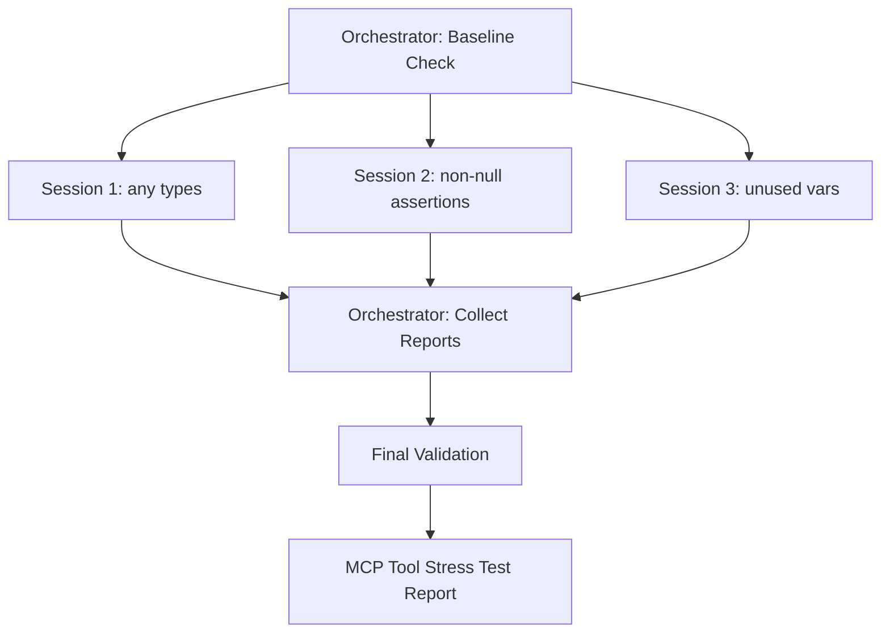

# 🎭 TypeScript/Lint Düzeltme Orkestrasyon Planı

**Toplam:** 282 problem (250 error, 32 warning)  
**Tarih:** 2026-01-30  
**Orchestrator:** ROVO AI  
**Paralel Session:** 3

---

## 📊 Hata Dağılımı

| Kategori | Sayı | Oran |
|----------|------|------|
| `@typescript-eslint/no-explicit-any` | 211 | 74.8% |
| `@typescript-eslint/no-non-null-assertion` | 34 | 12.1% |
| `@typescript-eslint/no-unused-vars` | 32 | 11.3% |
| `@typescript-eslint/consistent-type-imports` | 3 | 1.1% |
| `@typescript-eslint/no-empty-object-type` | 1 | 0.3% |

---

## 🎯 Session İş Dağılımı

### **Session 1: no-explicit-any Toplu Düzeltme (211 hata)**
**Sorumlu:** AI Assistant 1  
**Hedef:** `any` tiplerini uygun tiplerle değiştir  
**Strateji:**
- `hev_dev_safe_batch_refactor` ile toplu düzeltme
- Her 50 dosyada bir syntax check
- Rollback mekanizması aktif

**Dosya Grupları:**
1. `src/js/modules/asistan/` (en yoğun)
2. `src/js/modules/webview/`
3. `electron/opencode-sse-server/`
4. Diğer modüller

**MCP Tools:**
- `hev_dev_typescript_dashboard` (başlangıç baseline)
- `hev_dev_safe_batch_refactor` (ana işlem)
- `hev_dev_check_syntax` (doğrulama)
- `hev_fs_bash` (lint kontrolü)

**Beklenen Süre:** 15-20 dakika  
**Stres Test:** Büyük batch işlemlerinde timeout handling

---

### **Session 2: no-non-null-assertion Düzeltme (34 hata)**
**Sorumlu:** AI Assistant 2  
**Hedef:** `!` operatörlerini güvenli kontrollere dönüştür  
**Strateji:**
- `hev_dev_fix_typescript_batch` ile optional chaining
- Manuel incelemelerde `hev_dev_edit_lines`
- Her düzeltmede syntax check

**Dosya Grupları:**
1. `src/js/modules/asistan/tool-renderers/`
2. `src/js/pages/asistan-native/`
3. Diğer scattered dosyalar

**MCP Tools:**
- `hev_fs_show` (context okuma)
- `hev_dev_edit_lines` (manuel düzeltme)
- `hev_dev_fix_typescript_batch` (optional chaining)
- `hev_dev_check_syntax` (doğrulama)

**Beklenen Süre:** 10-15 dakika  
**Stres Test:** Safe mode ve rollback mekanizması

---

### **Session 3: no-unused-vars + Diğer Hatalar (36 hata)**
**Sorumlu:** AI Assistant 3  
**Hedef:** Kullanılmayan değişkenleri temizle, diğer hataları düzelt  
**Strateji:**
- `hev_fs_find_and_replace` ile simple fixes
- Import cleanup için `hev_dev_smart_insert`
- Type import düzeltmeleri

**Dosya Grupları:**
1. Unused vars (32 hata) - underscore prefix veya silme
2. `consistent-type-imports` (3 hata) - `import type` conversion
3. `no-empty-object-type` (1 hata) - `Record<string, never>`

**MCP Tools:**
- `hev_fs_grep` (pattern bulma)
- `hev_fs_find_and_replace` (basit değişiklikler)
- `hev_dev_edit_lines` (import düzeltme)
- `hev_dev_check_syntax` (doğrulama)

**Beklenen Süre:** 8-12 dakika  
**Stres Test:** Grep performance ve find-replace accuracy

---

## 🛡️ Güvenlik Protokolü

### Her Session İçin:
1. ✅ İşlem öncesi `hev_fs_bash("git status")` - clean state kontrolü
2. ✅ Her 10 dosyada bir `hev_dev_check_syntax`
3. ✅ `safe_mode: true` ve `auto_rollback_on_error: true` aktif
4. ✅ Duplicate detection her düzeltmeden sonra
5. ✅ İşlem sonrası `npm run lint` ve `npm run typecheck`

### Acil Durum:
```bash
# Eğer bir şey ters giderse
git checkout -- .
git clean -fd
```

---

## 📈 Metrikler (Her Session Raporlayacak)

### Performans:
- [ ] Toplam işlem süresi
- [ ] Dosya başına ortalama süre
- [ ] Başarılı düzeltme oranı
- [ ] Rollback sayısı

### MCP Tool Performansı:
- [ ] Hangi tool ne kadar kullanıldı?
- [ ] Timeout yaşandı mı?
- [ ] Error rate nedir?
- [ ] Öneriler/iyileştirmeler

### Kalite:
- [ ] Syntax hatası oluştu mu?
- [ ] Duplicate line tespit edildi mi?
- [ ] Manuel müdahale gerekti mi?

---

## 🎬 Execution Order



---

## ✅ Success Criteria

- [ ] Lint errors: 250 → 0
- [ ] Lint warnings: 32 → 0
- [ ] TypeScript errors: 0 (mevcut)
- [ ] Tüm testler geçiyor
- [ ] Build başarılı
- [ ] MCP tools stres testinde başarılı

---

## 📝 Final Rapor Formatı (Her Session)

```markdown
## Session [N] Raporu

### Özet
- Başlangıç: X hata
- Bitiş: Y hata
- Düzeltilen: Z hata
- Süre: M dakika

### MCP Tool Kullanımı
| Tool | Kullanım | Başarı | Timeout | Not |
|------|----------|--------|---------|-----|
| ... | ... | ... | ... | ... |

### Sorunlar & Öneriler
1. Tool X'te şu sorun yaşandı: ...
2. Tool Y için geliştirme önerisi: ...

### Kod Kalitesi
- Syntax error: Evet/Hayır
- Duplicate line: Evet/Hayır
- Manuel müdahale: Evet/Hayır
```

---

**Hazırladı:** ROVO Orchestrator  
**Onay Bekliyor:** ✋ User confirmation needed
